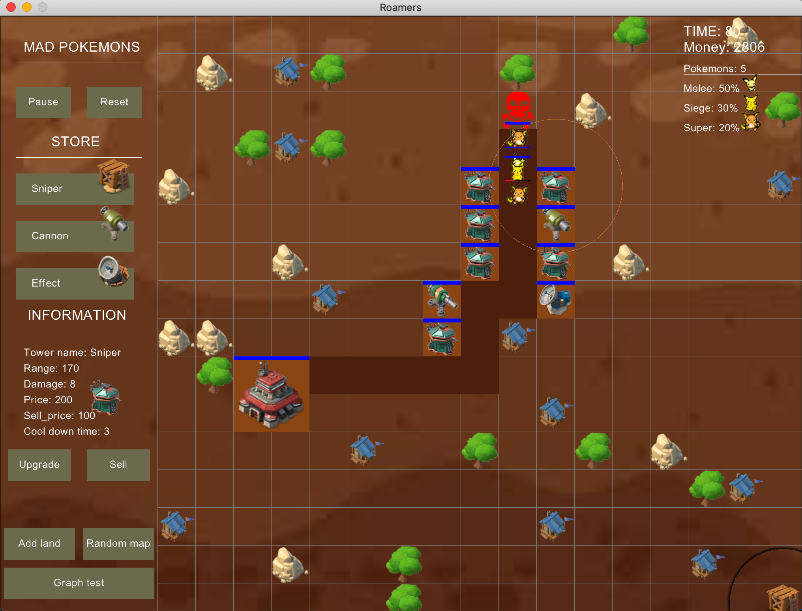

# Simple Tower Defense Game

A simple tower defense game built using the **Gosu** Ruby library.

---

## 🚀 Running the Game

Make sure you have the `gosu` gem installed:

```bash
gem install gosu
```

Then run the game:

```bash
ruby start.rb
```

---

## ⚙️ Settings

All game assets and settings can be modified in `settings.json`.

> I haven’t spent much time balancing the gameplay—feel free to tweak and improve it!

---

## 🖼️ UI Preview



---

## 💡 Gameplay Inspiration

Special thanks to **xithiox**  
https://github.com/xithiox/towerdefense

---

## 👾 Creep Assets

Huge thanks to **lautarodragan**  
https://github.com/lautarodragan/js-sprite-demo  
Live Demo: http://lautarodragan.github.io/js-sprite-demo/index.htm

---

## 🔄 Moving Objects in Gosu (Fixed Path)

Massive thanks to **lucascaton**  
https://github.com/lucascaton/alien_invasion

---

## 🏰 Tower & Terrain Assets

Based on:  
https://boombeach.fandom.com/wiki
